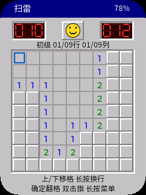

[简体中文](README.zh_CN.md) · **English**

# AI Passport Minesweeper

An offline, three-button Minesweeper game for the FoloToy AI Passport. The
application boots directly into a new beginner game. Its gray beveled cells,
colored numbers, red seven-segment counters and yellow smiley recall classic
Windows Minesweeper, with a new portrait layout for the 240 × 320 display.
It reuses the complete [AI Passport](https://gitee.com/FoloToy/ai-passport)
ESP32-C3 BSP; no touchscreen, extra wiring or network connection is required.



Software-rendered preview, with a sample battery value; physical display checks
remain pending.

## Rules and difficulty

| Level | Board | Mines |
| --- | --- | --- |
| Beginner | 9 × 9 | 10 |
| Intermediate | 16 × 16 | 40 |
| Expert | 30 × 16 | 99 |

- The first reveal and its surrounding eight cells are safe. Mines are generated
  on the first reveal, including when flags were placed beforehand.
- Zero cells expand automatically. Flags protect cells from expansion.
- Reveal every safe cell to win; flagging all mines is not required. On victory,
  remaining mines are automatically flagged and the counter reads zero.
- Reveal an open number to uncover its neighbors when the neighboring flag count
  matches that number. Incorrect flags can make this action hit a mine.
- On defeat, all mines appear, the triggered mine is red, and incorrect flags are
  crossed out. The board remains navigable after victory or defeat.
- The remaining-mine counter is mines minus flags and can become negative
  (its three-digit display bottoms out at -99).
  Elapsed time starts on the first reveal, pauses in menus, stops at the result,
  and displays at most 999 seconds.
- Large boards use a scrolling 9 × 9 viewport with the same 22-pixel cells,
  row/column coordinates and edge scroll indicators. Traditional random boards
  can require guessing; solvability without guessing is not guaranteed.

## Three-button controls

| Button | Short click | Double click | Hold (500 ms) |
| --- | --- | --- | --- |
| UP | Previous cell | Previous cell | Previous row, same column |
| DOWN | Next cell | Next cell | Next row, same column |
| OK | Reveal / chord | Toggle flag | Pause menu |

Cell traversal wraps across rows and the whole board. Row movement wraps at
the top/bottom. A directional double click is one move. OK's single and double
clicks are distinguished by the BSP's click window, so flagging does not reveal
the cell first. Simultaneous button chords are not used because all three
buttons share one ADC resistor ladder.

The pause menu offers resume/inspect, smiley restart, difficulty and help.
UP/DOWN select; OK confirms; hold OK returns. Restarting or selecting a difficulty
while playing opens a confirmation dialog that defaults to cancel. Selecting a
new difficulty starts a new game. In the help page, click or hold OK to return.

Battery percentage appears at the top right; unavailable readings show `--%`.
After 60 seconds without input, the game pauses and the backlight dims. After
120 seconds, the backlight turns off. The first gesture restores brightness;
its trailing click/hold is discarded. Select resume to continue. Radio and audio
stacks are not started. Games, difficulty and records are kept in RAM only;
power cycling starts a new beginner game.

## Build and firmware

Use ESP-IDF **5.5.3** for **ESP32-C3 / 8 MB Flash / no PSRAM**. Read
[AGENTS.md](AGENTS.md) and the [environment guide](docs/development/engineering/environment-setup.md).
Activate IDF and run:

```bash
./tools/validate.sh --static
./tools/validate.sh
```

The complete gate builds from tracked `sdkconfig.defaults`, checks the merged
layout, and saves `build/FoloToy-AI-Passport-full.bin`. This is the full image
for writing at **0x0**, including bootloader, partition table and application.
Matching ELF/MAP files and checksums are retained in `build/firmware/<sha256>/`.
Verify that directory with `python3 tools/archive_firmware.py verify <directory>`.
Generated firmware and toolchains are not committed.

The partition layout remains NVS at 0x9000, PHY at 0xF000 and one factory
application at 0x10000, extending to the 8 MB boundary. Writing the merged image
can reset existing NVS/PHY data. Flashing requires explicit device-specific
approval; a build or Git push does not authorize it. No full-chip erase or
original-firmware backup is required. See the [data policy](docs/development/engineering/firmware-layout.md).

## Validation and device acceptance

Host tests cover 600 generated boards, 100,000 randomized actions, exact mine
counts/adjacency, safe openings, flood fill, flags, chording, wins/losses,
immutable terminal states, navigation, scrolling, confirmation, timing and wake
suppression. Both generated fonts are checked against the fixed UI inventory;
startup also checks actual LVGL glyph descriptors with a missing-glyph negative
probe. Font materials and regeneration are in [assets](assets/README.md).

For actual LVGL software-renderer screenshots and a 300-redraw memory stress
check, use a separate LVGL **v9.5.0** source checkout:

```bash
cmake -S tests/lvgl_host -B build/preview -G Ninja \
  -DLVGL_SOURCE_DIR=/absolute/path/to/lvgl
cmake --build build/preview
mkdir -p build/screenshots
build/preview/minesweeper_preview build/screenshots
```

This renders the application code with a 24 KB LVGL pool and 40-line RGB565
buffer, including the BSP's rounded-screen geometry, to PPM images. It validates
software rendering, not the physical display or ADC timing.

On the device, verify boot stability and heap, Chinese text on every page,
number/flag/mine/cursor visibility, all short/double/long gestures, scrolling to
all expert-board corners, first-click safety, wrong-flag chording, victory and
loss, pause/resume/restart confirmation, battery fallback, and 60/120-second
idle/wake behavior. Measure button responsiveness, LCD output and power draw.
These checks remain unverified until approved flashing and observation.
